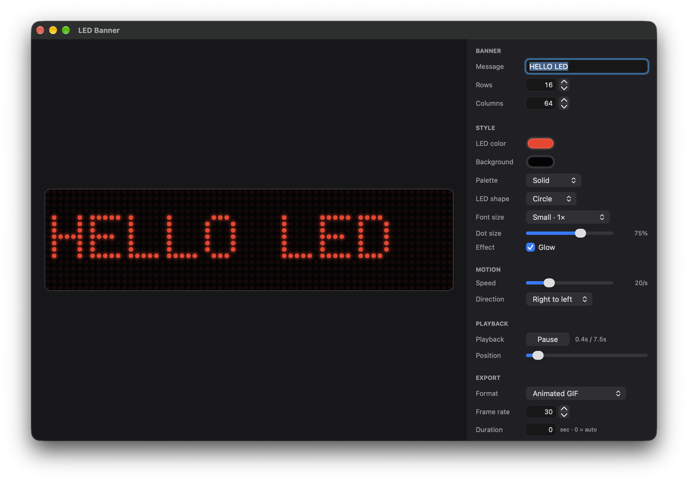

# LED Banner

Native macOS app (AppKit, 100% Objective-C, no third-party dependencies) that renders scrolling text on a simulated LED matrix and exports the animation as an animated GIF, MP4 (H.264), or MOV (ProRes 422).

 <!-- optional: add a screenshot under docs/ if you have one -->

## Features

- Real-time scrolling LED matrix preview with live configuration updates
- Custom message, matrix dimensions (rows × columns), font scale, direction, and speed
- Multiple palettes: solid LED color, rainbow (hue by column), plasma (hue by column and time)
- Dot ratio, glow, and shape controls
- Hand-encoded 5×7 bitmap font; lowercase maps to uppercase, unknown characters render as `?`
- Font scaling from 1× to 4× (each font pixel occupies `fontScale × fontScale` LEDs)
- Export animation as animated GIF (infinite loop via ImageIO), MP4 (H.264), or MOV (ProRes 422 via AVFoundation)
- Background export with progress reporting and cancellation
- Continuous scrolling: text enters, crosses the matrix, exits, and loops after a blank gap

## Requirements

- **Xcode path:** Xcode 14 or newer with the macOS SDK, or just the Xcode command line tools
- **Makefile builds:** macOS 10.13 or newer
- **Xcode project builds:** macOS 12.0 or newer (current SDK minimum)
- No package manager, no external libraries

## Build & Run

### Xcode

```sh
open "LED Banner.xcodeproj"       # shared scheme: "LED Banner"

xcodebuild -project "LED Banner.xcodeproj" \
  -scheme "LED Banner" \
  -configuration Debug \
  build
```

### Command line (Makefile)

```sh
make          # build ./build/LEDBanner
make run      # build and launch the raw binary
make app      # build build/LED Banner.app
open "build/LED Banner.app"
make test     # build and run headless engine/export tests
make snapshot # render the UI to build/ui-snapshot.png (dev helper)
make icon     # regenerate resources/AppIcon.icns from tools/make_icon.m
make clean
```

## Architecture

```
UI (AppKit)         MainWindowController + inspector controls, menu, save panel
Engine              LEBConfiguration, LEBGlyphFont, LEBFrameComposer, LEBCanvasView
Export              LEBExporter base, LEBGifExporter (ImageIO), LEBVideoExporter (AVFoundation)
```

- `LEBConfiguration` owns message, rows, columns, font scale, colors, palette, shape, dot ratio, glow, direction, speed, export FPS and duration. Posting `LEBConfigurationDidChangeNotification` refreshes the preview and layout.
- `LEBFrameComposer` is a pure renderer: `config + time + cell size` draws directly into a CoreGraphics context, producing BGRA frames usable by the preview and both exporters.
- Scrolling is continuous: text enters from one side, crosses the matrix, exits, and loops after a blank gap. `cycleDuration` derives from matrix width, message length, and scroll speed; `0` duration in the export panel means "one full cycle".
- The 5×7 bitmap font is hand-encoded in `LEBGlyphFont`; lowercase is mapped to uppercase and unknown characters render as `?`. Font size scales the glyphs by an integer factor from 1× to 4×, so each font pixel occupies `fontScale × fontScale` LEDs.
- Palettes: solid LED color, rainbow (hue by column), plasma (hue by column and time).
- GIF export uses `CGImageDestination` with infinite looping; video export uses `AVAssetWriter` + a pixel-buffer adaptor (H.264 for MP4, ProRes 422 for MOV).
- Exports run on a background queue, report progress on the main thread, and can be cancelled. The configuration is copied before export so UI edits cannot corrupt output.

## Project Layout

```
src/main.m
src/app/AppDelegate.{h,m}
src/app/MainWindowController.{h,m}
src/engine/LEBConfiguration.{h,m}
src/engine/LEBGlyphFont.{h,m}
src/engine/LEBFrameComposer.{h,m}
src/engine/LEBCanvasView.{h,m}
src/export/LEBExporter.{h,m}       # base class + GIF and video subclasses
src/export/LEBGifExporter.m
src/export/LEBVideoExporter.m
resources/Info.plist               # used by the Makefile bundle
resources/Info-Xcode.plist         # used by the Xcode target
resources/AppIcon.icns             # generated app icon (make icon)
tools/make_icon.m                  # CoreGraphics icon generator
tests/test_engine.m
tests/snapshot_ui.m
LED Banner.xcodeproj               # shared scheme "LED Banner", ad-hoc signed
```
